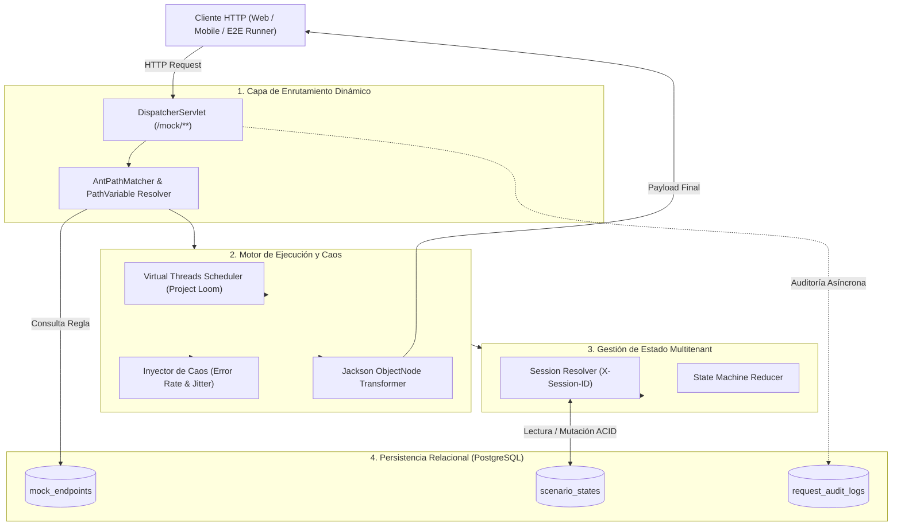

# Especificación Técnica: Propósito, Problemática y Arquitectura de la Solución

## 1. Definición Formal del Sistema

**`mocking-engine-state-simulator`** es un motor de simulación de APIs HTTP y emulación de estados mutable, diseñado para desacoplar el ciclo de desarrollo de aplicaciones cliente (Frontend Web, Aplicaciones Nativas Mobile) respecto a servicios backend remotos.

El sistema opera como un **interceptor/servidor sustituto programable** capaz de:
- Enrutar dinámicamente peticiones bajo patrones comodín (*wildcards*).
- Evaluar y transformar contratos de datos JSON en tiempo de ejecución.
- Mantener máquinas de estados finitos (*Finite State Machines*) aisladas por contexto de sesión.
- Inyectar fallos probabilísticos y latencias no bloqueantes simulando redes heterogéneas.
- Registrar trazas forenses completas para auditoría e inspección técnica.

---

## 2. Problemática Técnica en la Entrega de Software

En arquitecturas distribuidas basadas en microservicios y desarrollo cliente-servidor tradicional, los equipos de Frontend y Mobile enfrentan fricciones estructurales recurrentes:

```
┌─────────────────────────────────────────────────────────────────────────────────┐
│                           LIMITACIONES DEL MODELO TRADICIONAL                   │
├────────────────────────────┬────────────────────────────────────────────────────┤
│ Problema                   │ Impacto Técnico y Operativo                        │
├────────────────────────────┼────────────────────────────────────────────────────┤
│ Acoplamiento Temporal      │ Bloqueo de sprints frontend mientras backend       │
│ de Despliegue              │ implementa contratos acordados (OpenAPI/Swagger).  │
├────────────────────────────┼────────────────────────────────────────────────────┤
│ Fragilidad de Entornos de  │ Caídas de servicios dependientes en Staging        │
│ Staging / Preproducción    │ provocan fallos en cascada en las pruebas cliente. │
├────────────────────────────┼────────────────────────────────────────────────────┤
│ Inviabilidad de Pruebas    │ Dificultad para reproducir fallos catastróficos    │
│ de Caos (Resiliencia)      │ (HTTP 503, Timeouts, Rate Limits) en backend real. │
├────────────────────────────┼────────────────────────────────────────────────────┤
│ Rigidez de Mocks Estáticos │ Postman Mock Servers y fixtures JSON son estáticos:│
│ (Falta de Estado)          │ no persisten mutaciones ni flujos transaccionales. │
└────────────────────────────┴────────────────────────────────────────────────────┘
```

### Análisis de la Rigidez de Mocks Estáticos vs. Flujos con Estado
Un mock tradicional basado en archivos planos o servidores estáticos responde con idempotencia absoluta a cualquier estímulo. Si una interfaz móvil ejecuta un flujo de autorización y posterior consumo:
1. `POST /api/v1/auth/login` $\rightarrow$ Retorna token `jwt_mock`.
2. `POST /api/v1/checkout` $\rightarrow$ Debiera decrementar inventario y actualizar el balance.
3. `GET /api/v1/account/balance` $\rightarrow$ **Un mock estático retorna siempre el valor cableado inicial**, impidiendo verificar la actualización de la UI o transiciones de pantalla dependientes de estado.

---

## 3. Arquitectura y Mecanismos de Solución

La aplicación resuelve esta problemática mediante cinco subsistemas acoplados mediante Spring Boot 3 y persistidos en PostgreSQL:



### A. Enrutamiento Comodín y Resolución Dinámica de Contratos
* **Mapeo desacoplado:** Spring MVC captura todo el tráfico bajo el prefijo `/mock/**` a través de un controlador dinámico generalizado, derivando el path relativo y el método HTTP (`GET`, `POST`, `PUT`, `DELETE`, `PATCH`).
* **Coincidencia de patrones:** Utiliza correspondencia por expresiones de ruta (e.g. `/api/v1/users/{userId}`) extrayendo variables de segmento para su posterior inyección en la plantilla de respuesta JSON.

### B. Simulación de Caos y Latencia no Bloqueante (Java 21 Virtual Threads)
* **Emulación de red móvil:** Permite parametrizar latencias base con fluctuación aleatoria (*jitter* $\pm 15\%$) simulando perfiles de conectividad heterogéneos (Fast 4G, Slow 3G, redes inestables en tránsito).
* **Eficiencia de recursos:** Gracias a **Project Loom** (`spring.threads.virtual.enabled: true`), las pausas artificiales (`Thread.sleep`) desmontan el hilo virtual del hilo portador (*carrier thread*). El servidor puede sostener decenas de miles de peticiones simultáneamente en retardo sin incurrir en agotamiento de hilos (*thread starvation*).
* **Inyección de fallos probabilística:** Configuración de tasas de error estocásticas ($0.0 \le P \le 1.0$) devolviendo códigos de respuesta configurables (`429`, `500`, `502`, `504`) con cargas JSON representativas.

### C. Simulación de Estado por Sesión (*Stateful Engine*)
* **Segregación lógica multitenant:** Cada consumidor transmite una cabecera de correlación (e.g., `X-Session-ID: <session-key>`).
* **Persistencia mutable:** El estado de la sesión se almacena como un documento JSONB / TEXT en PostgreSQL (`ScenarioState`). Las transiciones de estado permiten que una petición HTTP mute campos específicos de la sesión (ej. decrementar balance, alternar flags de autenticación), condicionando las respuestas de llamadas posteriores.

### D. Trazabilidad Forense y Auditoría
* Registro síncrono/asíncrono de cada interacción HTTP en la tabla `request_audit_logs`:
  * Verbo HTTP, URI exacta consumida y código de estado retornado.
  * Cabeceras completas de entrada y salida.
  * Cuerpos crudos (*raw payloads*) transmitidos y recibidos.
  * Latencia real consumida en milisegundos.
* Proporciona a los desarrolladores una herramienta de diagnóstico inmediata frente a discrepancias entre cliente y servidor simulado.
