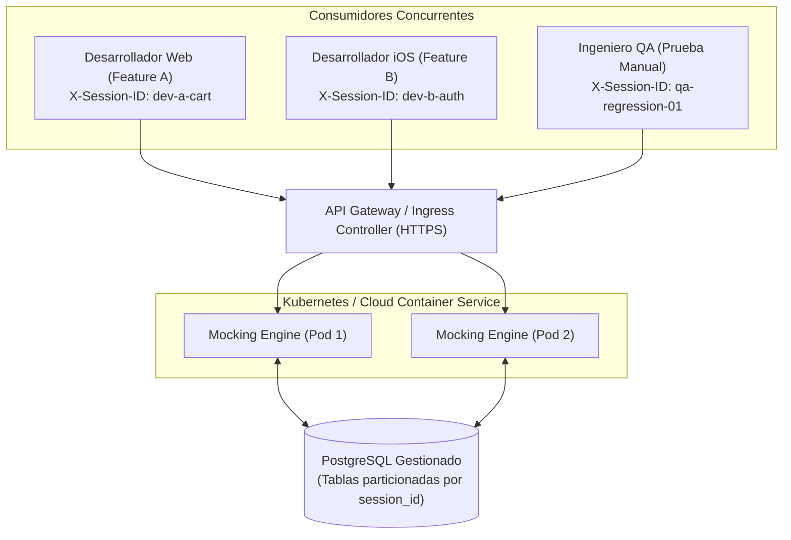

# Especificación Técnica: Topologías de Despliegue y Escenarios Operativos

Este documento describe los tres patrones de integración arquitectónica y operativa del **`mocking-engine-state-simulator`** dentro del ciclo de vida del desarrollo de software (SDLC).

---

## Matriz Comparativa de Topologías

| Dimensión Técnica | 1. Localhost Standalone | 2. Cloud Sandbox Centralizado | 3. Pipeline de CI/CD |
| :--- | :--- | :--- | :--- |
| **Infraestructura** | Docker Desktop / JVM local | Clúster Kubernetes / ECS / Cloud Run | Runners efímeros (GitHub Actions / GitLab) |
| **Aislamiento** | Total (Físico por máquina) | Lógico (Multitenancy con `X-Session-ID`) | Total (Contenedores efímeros por job) |
| **Persistencia** | PostgreSQL local efímero/local | PostgreSQL gestionado (RDS / Cloud SQL) | Testcontainers / DB en memoria descartable |
| **Conectividad** | Loopback (`127.0.0.1` / `10.0.2.2`) | Ingress HTTPS / VPN Corporativa | Red interna del runner (Bridge Docker) |
| **Objetivo Primario** | Desarrollo ágil y offline | Demos y testing multifuncional | Determinismo en pruebas E2E automatizadas |

---

## 1. Topología Localhost: Desarrollo Individual Autónomo

### Arquitectura de Red y Ejecución
En esta modalidad, cada desarrollador ejecuta la infraestructura completa en su estación de trabajo:
* Base de datos: Contenedor PostgreSQL aprovisionado vía `docker-compose.yml`.
* Aplicación: Instancia Spring Boot ejecutada mediante `mvn spring-boot:run` o binario JAR empaquetado.

```
┌────────────────────────────────────────────────────────────────────────┐
│                        ESTACIÓN DE TRABAJO LOCAL                       │
│                                                                        │
│   ┌────────────────────┐                   ┌───────────────────────┐   │
│   │   App Cliente      │                   │   Mocking Engine      │   │
│   │ (React / Flutter)  │─── HTTP Request ─>│ (Spring Boot / :8080) │   │
│   └────────────────────┘                   └──────────┬────────────┘   │
│                                                       │ JDBC           │
│                                                       ▼                │
│                                            ┌───────────────────────┐   │
│                                            │ PostgreSQL en Docker  │   │
│                                            │     (Puerto 5432)     │   │
│                                            └───────────────────────┘   │
└────────────────────────────────────────────────────────────────────────┘
```

### Protocolos de Enlace por Plataforma Cliente
* **Frontend Web (Vite / Webpack / Next.js):**
  La aplicación cliente apunta su variable de entorno base directamente al loopback:
  ```env
  VITE_API_BASE_URL=http://localhost:8080/mock
  ```
* **Emulador Android:**
  Dado que el emulador corre en un espacio de red virtualizado donde `127.0.0.1` apunta al propio emulador, el puente hacia el host se establece mediante la IP virtual del gateway:
  ```env
  API_BASE_URL=http://10.0.2.2:8080/mock
  ```
* **Simulador iOS:**
  Comparte directamente la interfaz de red del host macOS, consumiendo `http://localhost:8080/mock`.
* **Dispositivos Físicos:**
  Enlace mediante reenvío de puertos ADB (`adb reverse tcp:8080 tcp:8080`) o túnel inverso local.

### Casos de Uso
1. **Desarrollo Desconectado (*Offline-First*):** Capacidad de avanzar en la implementación de UI sin dependencia de conectividad externa ni VPN.
2. **Prototipado Inmediato de Contratos:** El desarrollador ajusta o sobrescribe esquemas de respuesta en milisegundos para validar el comportamiento visual ante payloads inesperados.

---

## 2. Topología Cloud Sandbox: Entorno Centralizado de Equipo

### Arquitectura Multitenant
La aplicación se despliega como servicio permanente en la infraestructura de pruebas o staging de la organización, expuesta bajo un nombre de dominio cualificado (e.g. `https://mock-engine.dev.internal.company.com`).



### Mecanismo de Aislamiento de Contexto (`X-Session-ID`)
Para evitar condiciones de carrera o colisión de datos cuando múltiples ingenieros interactúan simultáneamente sobre el mismo endpoint:
1. El middleware interceptor inspecciona la cabecera HTTP `X-Session-ID`.
2. Las mutaciones de estado se almacenan en la tabla `scenario_states` indexada por `(session_id, scenario_key)`.
3. El `DevA` puede forzar una condición de "saldo agotado" en su sesión mientras el `DevB` opera con "saldo infinito" en la suya sobre la misma ruta simulada.

### Casos de Uso
1. **Demos Funcionales a Stakeholders:** Ejecución de versiones de prueba en dispositivos móviles reales en manos de Product Owners sin requerir configuraciones de red complejas.
2. **Contrato Canónico Compartido:** Backend y Frontend formalizan el mock como especificación ejecutable única durante la fase de refinamiento.

---

## 3. Topología CI/CD: Pruebas Automatizadas Deterministas

### Arquitectura Hermética de Pipeline
En plataformas de integración continua (GitHub Actions, GitLab CI, Jenkins), la presencia de backends inestables o dependencias de red externas introduce **intermitencia (*flakiness*)**, provocando falsos negativos costosos.

```
┌────────────────────────────────────────────────────────────────────────┐
│                        RUNNER DE INTEGRACIÓN CONTINUA                  │
│                                                                        │
│   ┌────────────────────┐                  ┌────────────────────────┐   │
│   │ Runner E2E Tests   │── HTTP Request ─>│     Mocking Engine     │   │
│   │(Playwright/Cypress)│<─ Deterministic ─│  (Instancia Efímera)   │   │
│   └────────────────────┘                  └───────────┬────────────┘   │
│                                                       │                │
│                                                       ▼                │
│                                           ┌────────────────────────┐   │
│                                           │ PostgreSQL Efímero     │   │
│                                           │ (Testcontainers/Docker)│   │
│                                           └────────────────────────┘   │
└────────────────────────────────────────────────────────────────────────┘
```

### Ciclo de Ejecución de Pruebas
1. **Bootstrap del Entorno:** El runner inicia el contenedor del simulador (vía Testcontainers o servicio auxiliar de Docker Compose).
2. **Seed de Fixtures:** El test suite ejecuta una llamada a la API de administración (`POST /api/v1/admin/mocks/seed`) cargando el conjunto de mocks requeridos para la suite.
3. **Ejecución Asertiva:**
   * Caso Éxito: Verifica la renderización con datos estándar.
   * Caso Caos: Inyecta un error HTTP `500` con `delayMs: 3000` y comprueba que la UI muestra el componente de reintento tras el spinner de carga.
4. **Inspección Forense Asertiva:** El test suite consulta `GET /api/v1/admin/logs?sessionId=...` para asegurar que el cliente HTTP envió las cabeceras de autorización y el body conforme a la especificación.
5. **Teardown Inmediato:** Destrucción y liberación de recursos en el runner.

### Casos de Uso
1. **Hermeticidad de Pruebas E2E:** Asegura que una suite de pruebas frontend evalúe exclusivamente la lógica de interfaz sin riesgo de fallos atribuibles a incidencias de red o del backend.
2. **Pruebas de Regresión Visual:** Validación automatizada de pantallas de error, estados vacíos (*empty states*) y animaciones de carga.
