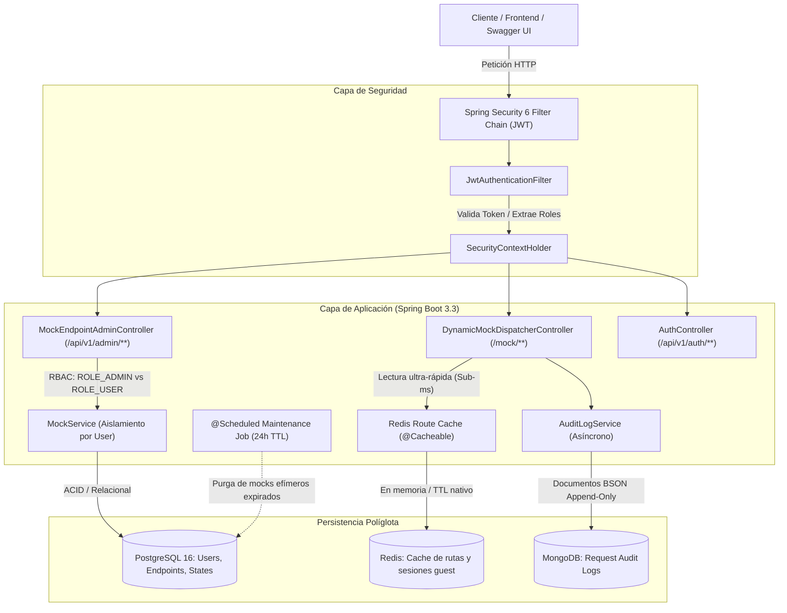

# Guía de Implementación: Fase 2 (Nivel Mid/Senior)

Bienvenido a la **Fase 2** del desarrollo de **Mocking Engine & State Simulator**.

Habiendo consolidado en la Fase 1 el núcleo funcional del motor (enrutamiento dinámico wildcard, simulación de red con hilos virtuales de Java 21, manipulación dinámica de JSON con Jackson y persistencia relacional con JPA y Testcontainers), la Fase 2 eleva el proyecto a **estándares empresariales avanzados** de arquitectura backend y preparación de portfolio profesional.

---

## 🎯 Objetivos de la Fase 2

1. **Aprendizaje Profundo de Spring Boot 3.3+**:
   * Dominar el nuevo modelo declarativo de **Spring Security 6** sin clases obsoletas.
   * Autenticación sin estado basada en **Tokens JWT** (JSON Web Tokens).
   * **Persistencia Políglota** (*Polyglot Persistence*): Coexistencia limpia de **PostgreSQL (JPA)** para datos transaccionales relacionales y **MongoDB** para ingesta masiva de logs semi-estructurados.
   * **Caché Distribuida y Expiración Nativa (TTL)** con **Redis** y Spring Data Redis.
   * Tareas en segundo plano y políticas de retención con `@Scheduled`.
   * Documentación interactiva viva con **Springdoc OpenAPI 3 (Swagger UI)**.

2. **Diferenciación en Portfolio para Reclutadores Técnicos**:
   * Arquitectura multi-tenant con aislamiento de recursos por usuario (`owner_id`) y modo **Guest Sandbox** efímero.
   * Demostración práctica de múltiples bases de datos (SQL + NoSQL Documental + Key-Value Cache).
   * Suite de pruebas ampliada con Testcontainers multi-contenedor (Postgres, MongoDB y Redis).

3. **Herramienta Práctica Robusta**:
   * Limpieza automática de datos huérfanos cada 24 horas.
   * Interfaz interactiva vía Swagger con botón de autenticación Bearer Token listo para usar.

---

## 🏗️ Arquitectura Técnica de la Fase 2

---

## 📚 Mapa Modular de la Fase 2

| Módulo | Archivo | Hitos de Aprendizaje |
| :--- | :--- | :--- |
| **09** | [09-seguridad-autenticacion-jwt.md](./09-seguridad-autenticacion-jwt.md) | Spring Security 6, `SecurityFilterChain`, JWT stateless, hashing BCrypt, endpoints `/auth/register` y `/auth/login`. |
| **10** | [10-rbac-multi-tenancy-guest-mode.md](./10-rbac-multi-tenancy-guest-mode.md) | Roles (`ROLE_USER`, `ROLE_ADMIN`), `@PreAuthorize`, segregación por propietario (`owner_id`) y Modo Invitado efímero. |
| **11** | [11-persistencia-poliglota-mongodb.md](./11-persistencia-poliglota-mongodb.md) | Coexistencia JPA + MongoDB, migración de `RequestAuditLog` a documento BSON, `MongoRepository` y tests con Testcontainers. |
| **12** | [12-cache-y-ttl-con-redis.md](./12-cache-y-ttl-con-redis.md) | Spring Data Redis, `@Cacheable` / `@CacheEvict` para matching de rutas, y TTL nativo (24h) para sesiones de invitados. |
| **13** | [13-tareas-programadas-limpieza-scheduled.md](./13-tareas-programadas-limpieza-scheduled.md) | Automatización con `@Scheduled`, expresiones cron, políticas de expiración y retención de datos. |
| **13b** | [13b-gestion-estados-escenario-1-n.md](./13b-gestion-estados-escenario-1-n.md) | Gestión de estados 1:N, namespacing (`usuario:estado`), cuota máxima de 5 estados y protección del estado `default`. |
| **14** | [14-openapi-swagger-y-portfolio.md](./14-openapi-swagger-y-portfolio.md) | Configuración de Springdoc OpenAPI, integración de autorización JWT en Swagger UI y recomendaciones de presentación para reclutadores. |

---

## 🛠️ Stack Tecnológico Añadido en la Fase 2

* **Seguridad:** Spring Security 6, JJWT (`io.jsonwebtoken`), Jakarta Authorization Annotations.
* **Persistencia NoSQL:** Spring Data MongoDB (driver reactivo/síncrono oficial).
* **Caché y Estructuras en Memoria:** Spring Data Redis (cliente Lettuce).
* **Documentación de APIs:** `springdoc-openapi-starter-webmvc-ui` (OpenAPI 3 / Swagger).
* **Testing:** Testcontainers para MongoDB y Redis junto a PostgreSQL.
