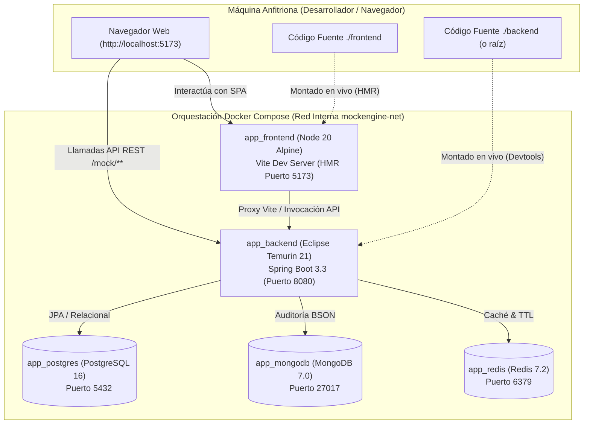

# Guía de Implementación: Fase 3 (Frontend SPA con React, Vite y Vitest)

Bienvenido a la **Fase 3** del desarrollo de **Mocking Engine & State Simulator**.

Tras culminar la arquitectura backend en Java 21 Spring Boot con seguridad, persistencia políglota y caché distribuida (Fase 1 y 2), esta fase se enfoca en el desarrollo de una **Single Page Application (SPA) moderna, reactiva y profesional** construida con **React 19**, **Vite**, **TypeScript**, **Tailwind CSS v4** y **Vitest**.

---

## 🎯 Objetivos de la Fase 3

1. **Entorno de Desarrollo Fullstack Unificado con Docker Compose**:
   * Orquestar en un único comando `docker compose up` todos los componentes del sistema: **PostgreSQL**, **MongoDB**, **Redis**, el **Backend de Spring Boot** y el **Frontend de React**.
   * Habilitar recarga en caliente en ambos lados: **Spring Boot Devtools** para el backend y **Vite Hot Module Replacement (HMR)** para el frontend, con aislamiento de `node_modules` en volumen anónimo.

2. **Frontend Moderno con Estándares de Industria (React 19)**:
   * Arquitectura basada en dominios de negocio (*Feature-Based / Bulletproof React*).
   * Separación estricta de estado de servidor (**TanStack Query v5**) y estado global de cliente/sesión (**Zustand v5**).
   * Estilos utilitarios de alto rendimiento con **Tailwind CSS v4** y componentes accesibles.
   * Testing unitario y de componentes con **Vitest**, **React Testing Library** y **Mock Service Worker (MSW v2)**.

3. **Módulos de Usuario y Herramientas del Simulador**:
   * **Autenticación y Sesión:** Login, Registro y botón de **Acceso Rápido como Invitado (1-Click Guest Sandbox)**.
   * **Mock Studio:** Creación y edición interactiva de endpoints con editor de JSON, selector de códigos de estado y validación visual de esquemas.
   * **Panel de Control de Caos:** Sliders interactivos para latencia (Fast 3G, Slow 3G, 4G, WiFi), tasa de fallo (%) y código de error inyectado.
   * **Monitor de Auditoría en Tiempo Real:** Inspección de peticiones entrantes, cabeceras, tiempos de respuesta y payloads JSON.

---

## 🏗️ Topología del Entorno Fullstack en Docker Compose

---

## 📚 Mapa Modular de la Fase 3

| Módulo | Archivo | Hitos de Aprendizaje |
| :--- | :--- | :--- |
| **15** | [15-docker-compose-fullstack-hmr.md](./15-docker-compose-fullstack-hmr.md) | Orquestación completa multi-contenedor (Postgres, Mongo, Redis, Backend, Frontend con HMR) y volúmenes aislados. |
| **16** | [16-setup-react-vite-vitest-tailwind.md](./16-setup-react-vite-vitest-tailwind.md) | Inicialización con Vite + React 19 + TypeScript, Tailwind CSS v4, Vitest y arquitectura de carpetas *Feature-Based*. |
| **17** | [17-auth-session-guest-frontend.md](./17-auth-session-guest-frontend.md) | Flujo de autenticación con JWT, Zustand store para sesión, 1-Click Guest Sandbox y cliente HTTP Axios/Fetch con interceptores. |
| **18** | [18-gestion-endpoints-mock-studio.md](./18-gestion-endpoints-mock-studio.md) | Mock Studio: CRUD visual de endpoints, editor interactivo de JSON, selector de métodos HTTP y plantillas dinámicas. |
| **19** | [19-chaos-control-state-dashboard.md](./19-chaos-control-state-dashboard.md) | Dashboard de Caos: simulación interactiva de perfiles de red, inyección de fallos, y visor de máquinas de estado por sesión. |
| **20** | [20-monitor-logs-testing-vitest.md](./20-monitor-logs-testing-vitest.md) | Visor de logs de auditoría en tiempo real, filtros avanzados por código HTTP y suite de pruebas de componentes con Vitest. |

---

## 🛠️ Stack Tecnológico Frontend

* **Runtime & Build:** Node.js 20+, Vite 6+, TypeScript 5+.
* **Librería UI:** React 19 (React Compiler First).
* **Gestión de Estado de Servidor:** TanStack Query v5 (React Query).
* **Gestión de Estado de Cliente:** Zustand v5 (Persist middleware para tokens JWT).
* **Estilos:** Tailwind CSS v4 con variables CSS nativas y Lucide Icons.
* **Testing:** Vitest, Testing Library React, @testing-library/user-event y MSW v2 (Mock Service Worker).
